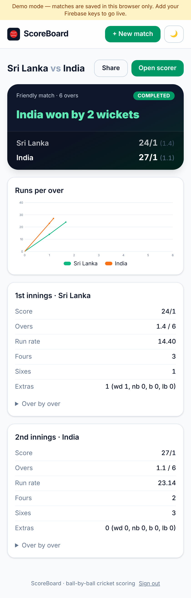
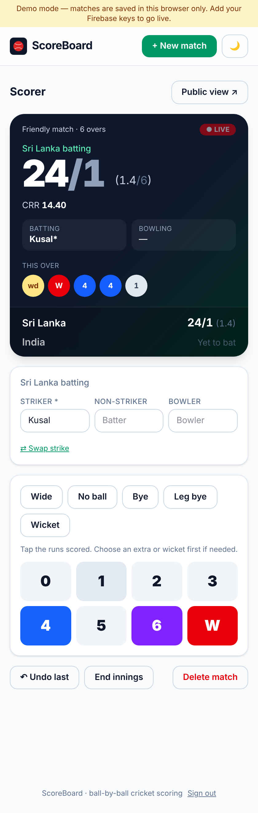

# 🏏 ScoreBoard — live cricket scoring

Score a cricket match ball by ball from your phone and share a link. Everyone watching sees every run, wicket and over the moment it happens.

**Stack:** React 19 · TypeScript · Vite · Tailwind CSS v4 · Firebase (Firestore + Auth) · installable PWA

| Live scoreboard                             | Scorer panel                            |
| ------------------------------------------- | --------------------------------------- |
|  |  |

## Features

- **Ball-by-ball scoring**: runs, fours, sixes, wides, no balls, byes, leg byes and wickets, plus **undo**
- Overs (e.g. `12.3`), current run rate, **target**, required runs, balls left and **required run rate**
- Automatic innings change, all-out and overs-up detection, and the result ("India won by 3 wickets", "Match tied")
- Striker, non-striker and bowler names, with automatic strike rotation on odd runs and at the end of each over
- **Real-time public scoreboard**: share `/match/<id>` and viewers' screens update instantly
- Runs-per-over "worm" chart comparing both innings, over-by-over breakdown, extras and boundary stats
- Google or email sign-in for scorers; only a match's creator can score it (enforced by Firestore rules)
- Dark mode, mobile-first layout, installable as an app on phones
- **Demo mode**: runs with no Firebase setup, saving to the browser only

Every number is calculated from the ball-by-ball log (`src/lib/cricket.ts`), so scores can't drift out of sync. That logic is unit-tested (`npm test`).

## Run it locally

```bash
npm install
npm run dev          # http://localhost:5173 — demo mode until you add Firebase keys
npm test             # scoring engine tests
```

## Set up Firebase (free Spark plan)

1. Go to [console.firebase.google.com](https://console.firebase.google.com) → **Add project** (Google Analytics is optional).
2. **Build → Firestore Database → Create database** → choose a location close to your users → start in **production mode**.
3. **Build → Authentication → Get started** → enable **Google** and **Email/Password**.
4. **Project settings (⚙) → Your apps → Web (`</>`)** → register an app and copy the config values.
5. Copy `.env.example` to `.env.local` and fill in the `VITE_FIREBASE_*` values.
6. Deploy the security rules:
   ```bash
   npm install -g firebase-tools
   firebase login
   firebase use --add            # pick your project, alias "default"
   firebase deploy --only firestore:rules
   ```

The Firebase web config is safe to ship in the browser. Access is controlled by `firestore.rules`, not by keeping the keys secret.

## Host it for free

### Option A — Firebase Hosting

```bash
npm run build
firebase deploy --only hosting     # → https://<project-id>.web.app
```

Or run `npm run deploy` to build and deploy everything.

### Option B — Vercel

1. Go to [vercel.com](https://vercel.com) → sign in with GitHub → **Add New → Project** → import this repo.
2. Vercel detects Vite automatically. Under **Environment Variables**, add the six `VITE_FIREBASE_*` values.
3. Click **Deploy**. Every push to `main` redeploys automatically.
4. In Firebase → **Authentication → Settings → Authorized domains**, add your `*.vercel.app` domain so Google sign-in works there.

## Project structure

```
src/
  lib/cricket.ts      scoring engine (pure, tested)
  lib/scoring.ts      add ball / undo / end innings transitions
  lib/store.ts        data layer: Firestore, or localStorage in demo mode
  pages/              Home, Login, NewMatch, MatchView (public), Scorer
  components/         LiveCard, ball chips, worm chart, innings stats
firestore.rules       who can read and write matches
legacy-java/          the original 2023 Java Swing + MySQL version
```

## History

v1 (2023) was a Java Swing desktop app with a local MySQL database. It's kept in [`legacy-java/`](legacy-java/). v2 rebuilds it as a web app so it can be hosted for free and used from any phone.
